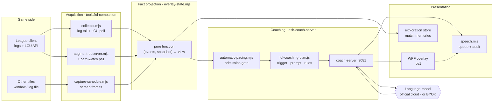
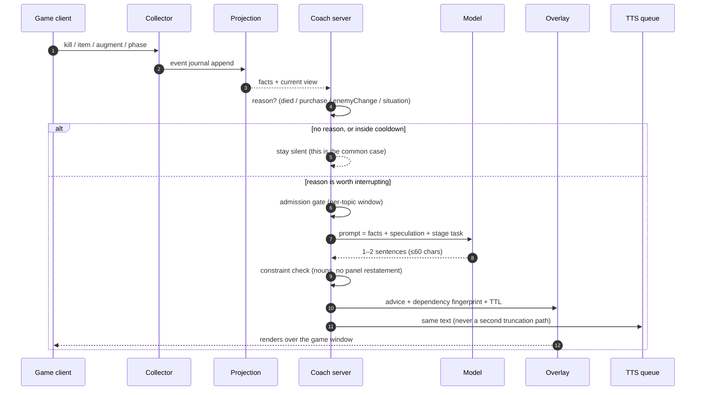
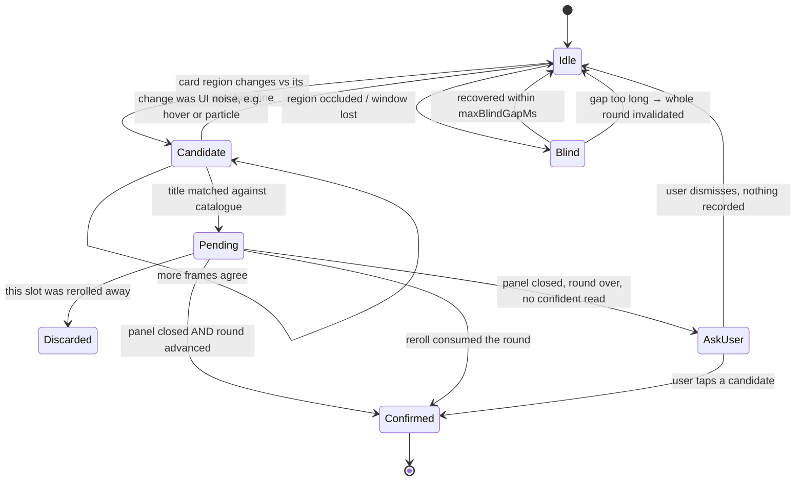
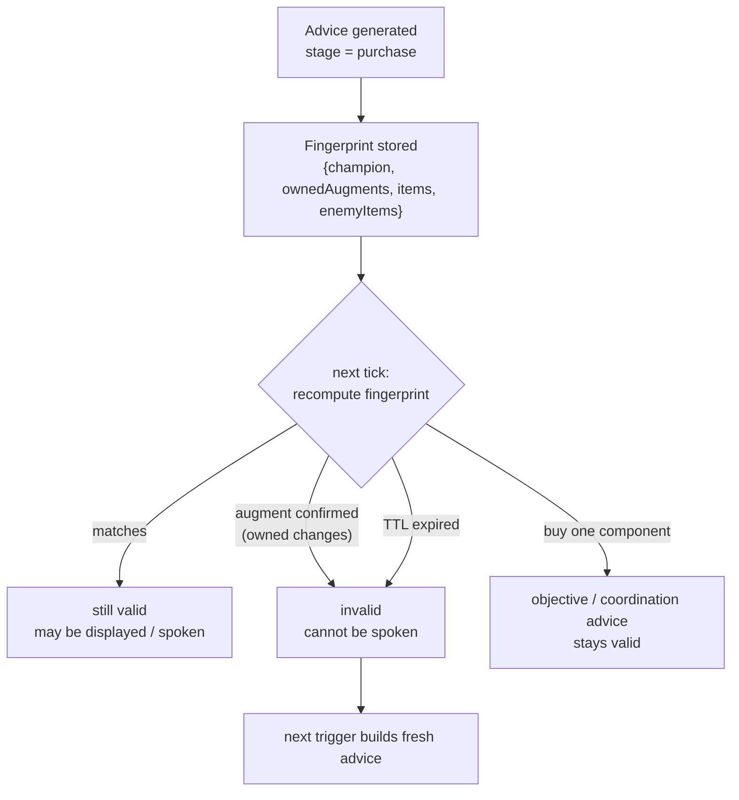
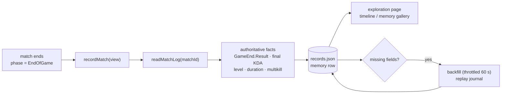
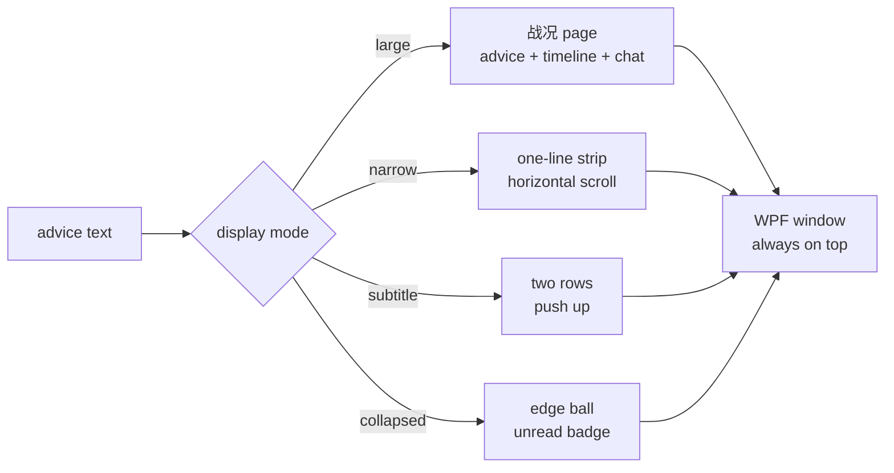
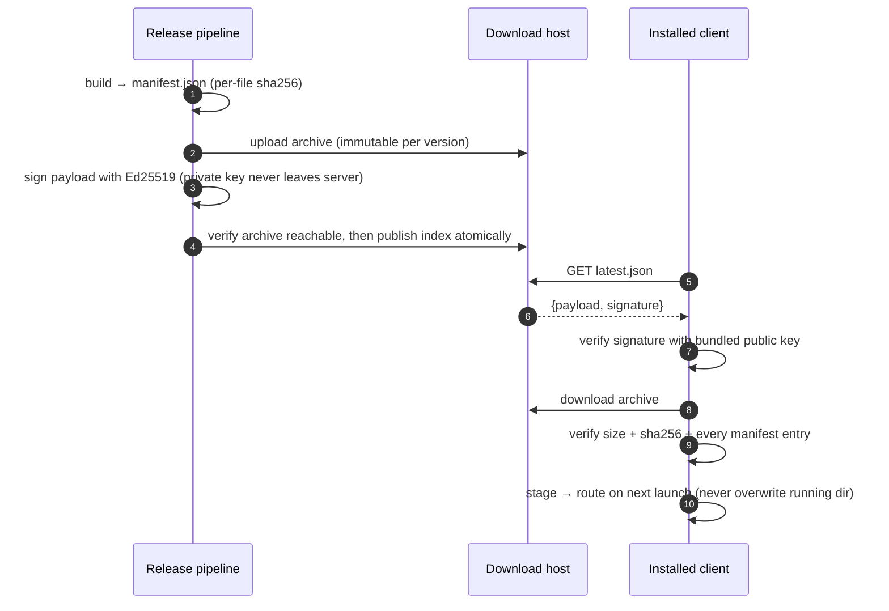
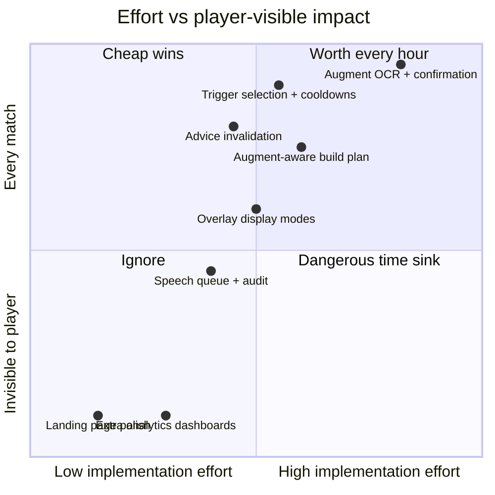

# Architecture

> A map of how Jinbao turns a game client's own telemetry into one sentence, and back again.
> Diagrams render natively on GitHub. For *why* the parts look like this, see
> [TECHNICAL_REPORT.md](TECHNICAL_REPORT.md).

---

## 1. System context



| Layer | Directory | Rule it must never break |
|---|---|---|
| Acquisition | `tools/lol-companion/` | Observations are append-only; nothing is rewritten after the fact |
| Projection | `tools/dsh-onboarding/overlay-state.mjs` | Pure: same events in, same view out |
| Coaching | `tools/dsh-coach-server/` | Facts and speculation are separated *in the prompt* |
| Presentation | `tools/desktop-release/` | Overlay failure must never kill the match pipeline |
| Delivery | `tools/jinbao-launcher/` | Ship only what the signature verifies |

---

## 2. One advice turn



The gate is deliberately boring: **most events produce nothing**. A coach that narrates every
event is noise, and noise is what makes players uninstall.

---

## 3. Augment observation lifecycle

Augment identity is not in the API — it is read off three card regions. The state machine exists so
that *nothing* is recorded without evidence.



| Guard | Value | Why |
|---|---|---|
| Frame freshness | ≤ 4 s | A stale frame must not confirm a live round |
| Blind gap tolerance | 15 s | Beyond this, previous readings are untrustworthy |
| Punctuation normalization | applied | `质变．棱彩阶` must match `质变：棱彩阶` |
| Title joining | same card only | OCR wraps long titles; descriptions are never fuzzy-matched |
| Fallback | confirmation panel | A wrong fact poisons every later recommendation |

---

## 4. Advice validity and invalidation

Advice is not "valid until 60 seconds pass". Each recommendation records **what it depends on**.



| Stage | Depends on | TTL |
|---|---|---|
| `opening` (6-item plan) | champion **+ owned augments** | 10 min |
| `augment` (three-way choice) | champion, owned, current offers | 90 s |
| `postAugment` (how to play it) | champion, owned | 90 s |
| `death` / `purchase` | champion, phase, level band, completed items, owned, enemy items | 45 s |
| `objective` / `turret` / `ace` / `coordination` | champion, phase, alive allies, alive enemies | 45 s |

The `opening` row is the one that caused a real bug: it used to depend on champion only, so a
build order generated before the first augment survived for ten minutes — while a later single
recommendation told the player to build the very item the plan omitted.
Case study: [TECHNICAL_REPORT.md §6](TECHNICAL_REPORT.md#6-case-study-augments-that-name-items).

---

## 5. Match memory pipeline

Every finished match leaves one local record. Nothing is uploaded.



| Field | Authoritative source |
|---|---|
| Win / lose | `GameEnd.Result` in the match journal |
| KDA, level | last state snapshot before `PreEndOfGame` |
| Duration | `GameEnd.EventTime` |
| 三杀 / 四杀 / 五杀 / 团灭 | `Multikill.KillStreak` and `Ace` events |
| Augments | confirmed picks only (never pending) |


---

## 6. Presentation modes



| Mode | Height | Keeps last sentence? | Use case |
|---|---|---|---|
| Large | ~380 px | yes | Default; full advice + timeline |
| Narrow | 72 px | yes (strip) | Wants advice, not a panel |
| Subtitle | ~90 px | yes (2 rows) | Looks like game subtitles |
| Collapsed | 44 px ball | no (badge only) | Full-screen attention |

Subtitle rules: punctuation never starts a line, number tokens (`No.22`, `53.5%`, `15/6/16`) stay
whole, and only two rows are ever visible.


---

## 7. Update integrity

Binaries never live in the repository. The client trusts exactly one thing: a signature.



| Control | Implementation |
|---|---|
| Tamper resistance | Ed25519 over the exact payload bytes; fixed official origin |
| Rollback safety | Immutable version paths + atomic index publish |
| Partial download | Size + per-file hash verification before staging |
| Failure policy | Any mismatch → keep running the old version silently |

---

## 8. Local state layout

```text
%USERPROFILE%\.jinbao-cloud-preview\
├── logs\
│   ├── lol-live-<ts>.jsonl        # one file per match: kills, items, augments, phases
│   ├── coach_broadcasts.jsonl     # every published advice + its stage
│   ├── speech.jsonl               # queued / started / completed / interrupted / discarded
│   ├── agent-activity.jsonl       # tool calls, durations, failures
│   └── overlay-mode.jsonl         # display mode changes + unhandled UI exceptions
├── exploration\records.json       # match memories + explored entries
├── overlay-diagnostics\           # overlay stdout/stderr (crash stacks)
├── diagnostics\<start>\           # per-launch diagnostics, last 10 kept
├── updates\                       # staged release, status, result
└── credentials.dpapi              # DPAPI-encrypted, per Windows user
```

Everything above is local. The diagnostics exporter redacts chat text, player names, credentials and
screenshots before producing a shareable bundle.

---

## 9. Where the difficulty actually is



The top-left cluster is why this project exists: things that are cheap to *say* and expensive to
*get right*.

---

## 10. Reading order for new contributors

| If you want to… | Start here |
|---|---|
| Understand why a recommendation exists | `tools/dsh-coach-server/lib/lol-coaching-plan.js` |
| Change what the overlay looks like | `tools/desktop-release/overlay-ui.ps1` |
| Fix a "it said nothing" bug | `logs/coach_broadcasts.jsonl` → trigger reasoning |
| Fix a "it said the wrong thing" bug | `logs/lol-live-*.jsonl` → facts, then the prompt |
| Touch speech | `tools/cloud-desktop/speech.mjs` + `logs/speech.jsonl` |
| Touch the updater | `tools/jinbao-launcher/update.mjs` (verify before you change anything) |

> PowerShell files must be **UTF-8 with BOM** and use **only `#` comments**. A single `//` line once
> crashed the overlay on collapse — see [TECHNICAL_REPORT.md §9](TECHNICAL_REPORT.md#9-failure-modes-and-lessons).
